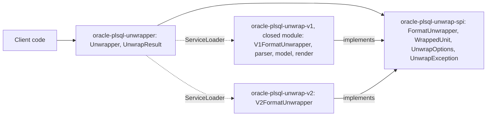

# 0001. Format-neutral API and isolation of the V1 implementation

[Русская версия](0001-v1-format-neutral-api_ru.md)

## Context

The library restores PL/SQL source code from the Oracle wrapped formats. In format V1 (Oracle 7.2, 7.3, 8, 8i, 9i) a
unit contains a lexicon and a DIANA tree. A V1 unit records the PL/SQL version, not the Oracle version: 2.2 for Oracle
7.2, 2.3 for Oracle 7.3, and from then on the numbers match (8.0, 8.1, 9.0, 9.2). Format V2 (Oracle 10g and later)
has nothing in common with V1: a unit stores compressed source text without a DIANA tree (ADR 0009). The formats share
only one thing: a wrapped unit in a text turns into source text. A script may contain units of different formats mixed
with plain SQL.

The implementation of V1 is a closed module: `oracle-plsql-unwrap-v1` is not a part of this project and its code is not
public. For the details contact the author: [ashindarev@gmail.com](mailto:ashindarev@gmail.com) or
[LinkedIn](https://www.linkedin.com/in/ashindarev/).

Requirements:

- the user works with one API regardless of the format;
- the format of a unit is detected by its header;
- adding a format does not change the public API;
- V1 types (the DIANA model, PL/SQL versions 2.2–9.2) are not visible to the user.

## Decision

Packages:

| Package                               | Module                      | Purpose                                                                                                                  | Exported |
|---------------------------------------|-----------------------------|--------------------------------------------------------------------------------------------------------------------------|----------|
| `com.github.sftwnd.oracle.unwrap`     | `oracle-plsql-unwrapper`    | public API: `Unwrapper`, `UnwrapResult`; script assembly                                                                 | yes      |
| `com.github.sftwnd.oracle.unwrap.cli` | `oracle-plsql-unwrapper`    | command line: `UnwrapperCli`                                                                                             | no       |
| `com.github.sftwnd.oracle.unwrap.spi` | `oracle-plsql-unwrap-spi`   | format contract: `FormatUnwrapper`, `WrappedUnit`, `SourceLines`; what both sides use: `UnwrapOptions`, `UnwrapException` | yes      |
| `com.github.sftwnd.oracle.unwrap.v2`  | `oracle-plsql-unwrap-v2`    | V2 implementation: `V2FormatUnwrapper` and the package-private classes of ADR 0009                                       | no       |
| `com.github.sftwnd.oracle.unwrap.v1`  | `oracle-plsql-unwrap-v1`    | closed module, V1 implementation: `V1FormatUnwrapper`, subpackages `parser`, `model`, `render`                           | no       |

Format contract:

- `FormatUnwrapper.find(text, from)` — position of the header of the next unit of the format; the unit content is not
  parsed;
- `FormatUnwrapper.read(text, start)` — parses the unit into a `WrappedUnit`;
- `FormatUnwrapper.format()`, `description()` and `withOptions(options)` — the name, the coverage and the options of the
  format;
- `WrappedUnit` — unit boundaries in the text, type and name from the header, PL/SQL release and compatibility group
  (as strings, `null` if the format does not store them), restoring the text on demand;
- `SourceLines` — the line break of the header line, which the restored text uses, the line number of an offset for
  error messages and the check of an offset; the formats count lines the same way.

`Unwrapper` finds the formats with `ServiceLoader`, polls all of them, takes the nearest header, parses the unit and
continues the search after its end. An option of one format reaches it through `FormatUnwrapper.withOptions`
(`strayCr` of `V2FormatUnwrapper`, ADR 0007 and ADR 0017).
Script assembly (`ScriptUnwrapper`) uses only the boundaries and text of units, so it is common to all formats: text
outside units is copied unchanged, and the rest of a unit up to and including the `/` line is discarded.

The closed module `oracle-plsql-unwrap-v1` exports nothing: it provides the service, and its distribution adds it to the
unwrapper of this project. Without it a V1 unit is reported as an error (ADR 0011).

## Rationale

- The common abstraction is drawn at the level "wrapped unit → text". Intermediate structures (the parser/renderer
  pair, the DIANA model) exist only in V1.
- Search is separated from parsing. `supports` checks only headers and does not fail on corrupted content, and units
  of different formats in one script are found in the order they appear.
- A unit header is recognized only by the unit's own format. There is a single point where units are detected, so
  script assembly cannot diverge from parsing.
- The module hides the format implementations, even though the V1 classes are public for the sake of links between
  subpackages.
- The format name is a string, not an enumeration: an enumeration in the SPI would have to list the formats, so a
  format could not be added without changing the SPI.

## Alternatives

- **A separate facade per format (`V1Unwrapper`, `V2Unwrapper`).** The user would have to detect the format
  themselves, and a script with units of different formats could not be processed in one call.
- **A common "parser + renderer" interface with an intermediate model.** A format without DIANA has no intermediate
  model, so such an interface would be artificial.
- **An enumeration of the formats.** See Rationale.
- **Public access to the DIANA model.** Ties the API to V1. If users need tree analysis, it should be provided as a
  separate API of the V1 implementation.

## Consequences

- A new format is a `FormatUnwrapper` implementation in its own module. The public API does not change.
- The DIANA model, V1 parsing and V2 decoding are not available to the user. Diagnostics go through `UnwrapException`
  messages; parse errors contain the line number.
- On the module path the internal packages are closed. On the classpath they are visible but are not part of the API.
- The output format (the line ending of the wrapped unit, the terminating `/` line) is common to all formats and
  fixed by the `WrappedUnit.unwrap()` contract; see ADR 0007.
