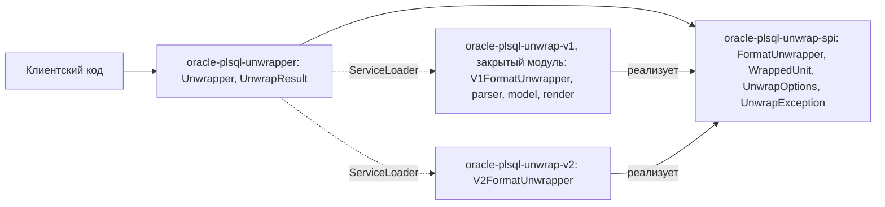

# 0001. API, независимый от формата, и изоляция реализации V1

[English version](0001-v1-format-neutral-api.md)

## Контекст

Библиотека восстанавливает исходный PL/SQL-код из wrapped-форматов Oracle. В формате V1 (Oracle 7.2, 7.3, 8, 8i, 9i)
единица содержит лексикон и дерево DIANA. В единице V1 записана версия PL/SQL, а не Oracle: 2.2 у Oracle 7.2, 2.3
у Oracle 7.3, далее номера совпадают (8.0, 8.1, 9.0, 9.2). Формат V2 (Oracle 10g и новее) не имеет с V1 ничего
общего: единица хранит сжатый исходный текст без дерева DIANA (ADR 0009). Общее у форматов одно — wrapped-единица
в тексте превращается в исходный текст. Скрипт может содержать единицы разных форматов вперемешку с обычным SQL.

Реализация V1 — закрытый модуль: `oracle-plsql-unwrap-v1` не входит в этот проект, и его код не публикуется. Детали можно
уточнить у автора: [ashindarev@gmail.com](mailto:ashindarev@gmail.com) или
[LinkedIn](https://www.linkedin.com/in/ashindarev/).

Требования:

- пользователь работает с одним API независимо от формата;
- формат единицы определяется по её заголовку;
- добавление формата не меняет публичный API;
- типы V1 (модель DIANA, версии PL/SQL 2.2–9.2) не видны пользователю.

## Решение

Пакеты:

| Пакет                                 | Модуль                      | Назначение                                                                                                                | Экспорт |
|---------------------------------------|-----------------------------|---------------------------------------------------------------------------------------------------------------------------|---------|
| `com.github.sftwnd.oracle.unwrap`     | `oracle-plsql-unwrapper`    | публичный API: `Unwrapper`, `UnwrapResult`; склейка скрипта                                                               | да      |
| `com.github.sftwnd.oracle.unwrap.cli` | `oracle-plsql-unwrapper`    | командная строка: `UnwrapperCli`                                                                                          | нет     |
| `com.github.sftwnd.oracle.unwrap.spi` | `oracle-plsql-unwrap-spi`   | контракт формата: `FormatUnwrapper`, `WrappedUnit`, `SourceLines`; общее для обеих сторон: `UnwrapOptions`, `UnwrapException` | да      |
| `com.github.sftwnd.oracle.unwrap.v2`  | `oracle-plsql-unwrap-v2`    | реализация V2: `V2FormatUnwrapper` и непубличные классы пакета из ADR 0009                                                | нет     |
| `com.github.sftwnd.oracle.unwrap.v1`  | `oracle-plsql-unwrap-v1`    | закрытый модуль, реализация V1: `V1FormatUnwrapper`, подпакеты `parser`, `model`, `render`                                | нет     |

Контракт формата:

- `FormatUnwrapper.find(text, from)` — позиция заголовка следующей единицы формата; содержимое единицы не
  разбирается;
- `FormatUnwrapper.read(text, start)` — разбор единицы в `WrappedUnit`;
- `FormatUnwrapper.format()`, `description()` и `withOptions(options)` — имя, охват и параметры формата;
- `WrappedUnit` — границы единицы в тексте, тип и имя из заголовка, выпуск и группа совместимости PL/SQL (строками,
  `null`, если формат их не хранит), восстановление текста по запросу;
- `SourceLines` — окончание строки заголовка, которым пользуется восстановленный текст, номер строки по смещению для
  сообщений об ошибках и проверка смещения; строки форматы считают одинаково.

`Unwrapper` находит форматы через `ServiceLoader`, опрашивает их все, берёт ближайший заголовок, разбирает единицу и
продолжает поиск после её конца. Параметр одного формата доходит до него через `FormatUnwrapper.withOptions`
(`strayCr` у `V2FormatUnwrapper`, ADR 0007 и ADR 0017).
Склейка скрипта (`ScriptUnwrapper`) пользуется только границами и текстом единиц, поэтому общая для форматов: текст
вне единиц переносится без изменений, остаток единицы до строки `/` включительно отбрасывается.

Закрытый модуль `oracle-plsql-unwrap-v1` ничего не экспортирует: он поставляет сервис, а его дистрибутив добавляет этот
сервис к unwrapper данного проекта. Без него единица V1 сообщается как ошибка (ADR 0011).

## Обоснование

- Общая абстракция проведена на уровне «wrapped-единица → текст». Промежуточные структуры (пара «парсер/рендерер»,
  модель DIANA) есть только у V1.
- Поиск отделён от разбора. `supports` проверяет только заголовки и не падает на повреждённом содержимом, а единицы
  разных форматов в одном скрипте находятся в порядке следования.
- Заголовок единицы распознаёт только её формат. Точка обнаружения единиц одна, поэтому склейка не может разойтись
  с разбором.
- Модуль скрывает реализации форматов, хотя классы V1 публичны ради связей между подпакетами.
- Имя формата — строка, а не перечисление: перечисление в SPI пришлось бы дополнять, и формат нельзя было бы добавить,
  не меняя SPI.

## Альтернативы

- **Отдельный фасад на каждый формат (`V1Unwrapper`, `V2Unwrapper`).** Пользователю пришлось бы определять формат
  самому, а скрипт с единицами разных форматов не обработать одним вызовом.
- **Общий интерфейс «парсер + рендерер» с промежуточной моделью.** У формата без DIANA нет промежуточной модели,
  такой интерфейс был бы надуманным.
- **Перечисление форматов.** См. обоснование.
- **Публичный доступ к модели DIANA.** Привязывает API к V1. Если анализ дерева понадобится пользователям, его
  стоит оформить отдельным API реализации V1.

## Последствия

- Новый формат — это реализация `FormatUnwrapper` в своём модуле. Публичный API при этом не меняется.
- Модель DIANA, разбор V1 и декодирование V2 недоступны пользователю. Диагностика — через сообщения
  `UnwrapException`; ошибки разбора содержат номер строки.
- На module path внутренние пакеты закрыты. На classpath они видимы, но не входят в API.
- Формат вывода (окончание строк wrapped-единицы, завершающая строка `/`) общий для всех форматов и закреплён
  контрактом `WrappedUnit.unwrap()`; см. ADR 0007.
