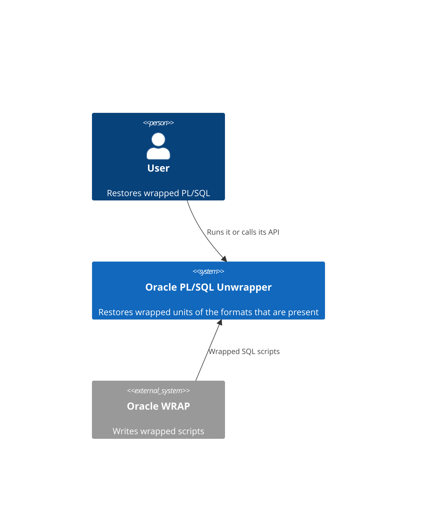
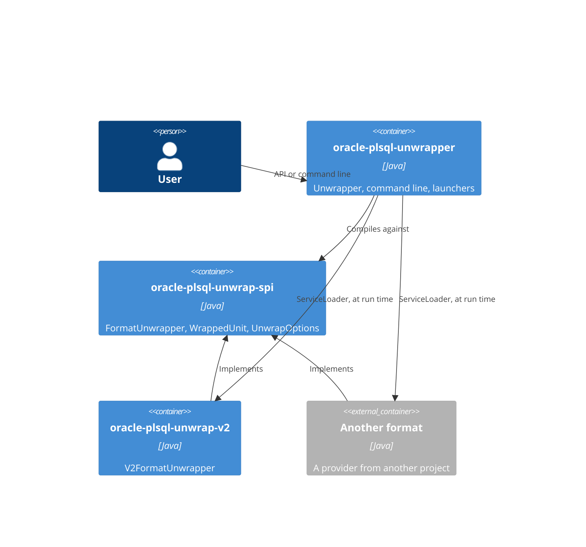

# 0011. Modules and format services

[Русская версия](0011-modules-and-format-services_ru.md)

## Context

A format is a large independent piece of code, and a user may need one format without the other. A format must therefore
be delivered on its own and be added to an application without a change of the unwrapper. The project
`oracle-plsql-unwrapper-pro`, which holds the format V1, has to reuse everything here and add only that format.

## Decision

The project is a Maven reactor with three modules:

| Module                      | Holds                                                     | Depends on                                   |
|-----------------------------|-----------------------------------------------------------|----------------------------------------------|
| `oracle-plsql-unwrap-spi`   | the contract of a format, options, the exception          | nothing                                      |
| `oracle-plsql-unwrap-v2`    | the format V2, a provider of the service                  | the SPI                                      |
| `oracle-plsql-unwrapper`    | `Unwrapper`, script assembly, the command line, launchers | the SPI; `oracle-plsql-unwrap-v2` at run time |

C4, level of the system:

C4, level of the containers:

- A format depends on the SPI only. The unwrapper compiles against the SPI only: no code refers to a format, and
  `oracle-plsql-unwrap-v2` is a dependency of the scope `runtime`.
- `Unwrapper` finds the formats with `ServiceLoader`, in the order of their names; of two implementations of one format
  the first found is kept, and without a format the constructor fails with `IllegalStateException`.
- A format declares itself in three ways, one for each way to run it: `META-INF/services` for the class path,
  `provides` in `module-info` for the module path, the capability `osgi.serviceloader` for OSGi (ADR 0012).
- `FormatUnwrapper` needs a public constructor without parameters, so the options come later, with `withOptions`, which
  returns the format to use. A format without options inherits a method that returns the format itself.
- `Unwrapper.formats()` lists the names and descriptions of the formats. The help of the command line prints them, so
  it tells what the distribution restores, and the same code serves a distribution with other formats.
- Without an implementation of the format V1 a unit of this format is found by `V1UnitRejector`, a class of the
  unwrapper and not a service, and reported with `UnwrapException`. An implementation with the name `V1` replaces it.
- Each module with samples or shared tests attaches a test jar: `Samples` and `ReferenceChecksums` of the SPI, the
  samples of V2, the launch test of the unwrapper.
- The artifact `oracle-plsql-unwrapper` holds the unwrapper with the format V2 only. The artifact
  `oracle-plsql-unwrapper-pro` of the project of the same name depends on it and adds the format V1.

## Rationale

- The dependency rule of Clean Architecture holds: the details (the formats) depend on the abstraction (the SPI), and
  the unwrapper is closed for changes when a format is added. The compiler checks it: there is no dependency to refer to.
- `ServiceLoader` is part of the JDK on all the versions, and the same provider works on the class path and on the
  module path, so no library is needed for it.
- `withOptions` keeps one service interface. A separate factory interface would add a type for one option.
- A V1 unit that stayed wrapped in a restored script would go unnoticed, so it is an error, and the message tells where
  to get a license. The rejector is not a service: a service would have to step aside for the real format, which needs a
  priority in the SPI for the sake of one class.
- A distribution differs only in its dependencies: the command line has no list of formats to keep in step.

## Alternatives

- **A list of formats in `Unwrapper`.** The unwrapper would depend on each format, and a format of another project
  could not be added.
- **A provider method `create(options)` in a separate factory interface.** Two types in the SPI where one is enough.
- **A format name in an enumeration.** See ADR 0001.
- **The SPI types in the base package.** The module of the unwrapper exports that package too, and JPMS does not allow
  one package in two modules.
- **One artifact name for both unwrappers.** The artifact with the format V1 depends on this one, so the names must
  differ.
- **A second command line for the distribution with V1.** It would repeat this one word for word.

## Consequences

- The public API spans two packages: `Unwrapper` and `UnwrapResult` in `com.github.sftwnd.oracle.unwrap`, `UnwrapOptions`
  and `UnwrapException` in `com.github.sftwnd.oracle.unwrap.spi`.
- `UnwrapResult.format()` is a string.
- What `Unwrapper` restores depends on the class path or the module path of the application.
- `ServiceLoader` works with the context class loader of the thread that creates `Unwrapper`.
- A new format needs no change here: a module with a provider, on the class path or the module path of the application.
