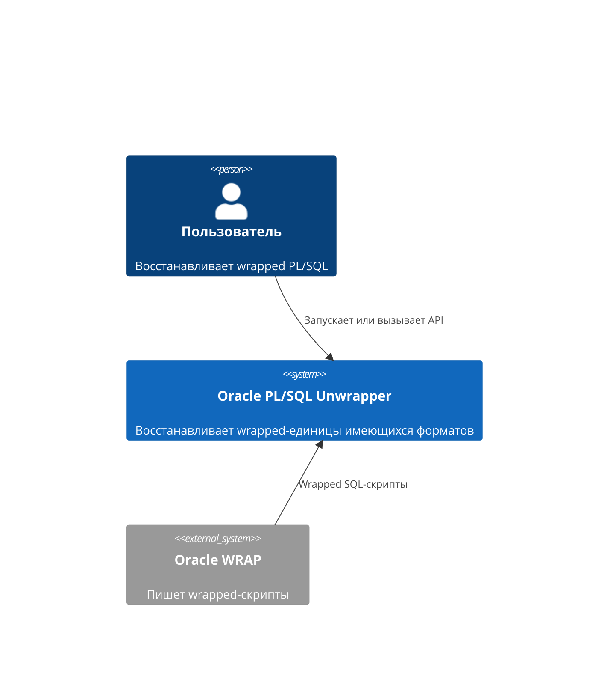
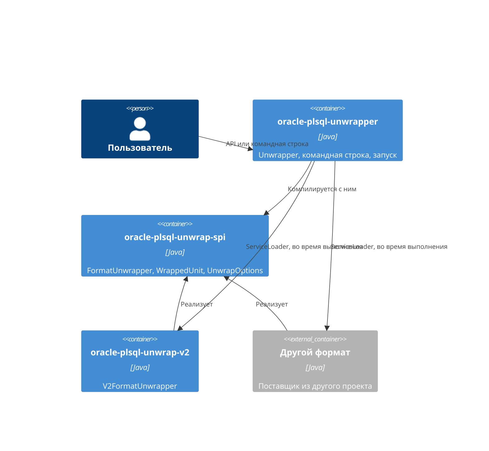

# 0011. Модули и сервисы форматов

[English version](0011-modules-and-format-services.md)

## Контекст

Формат — большой самостоятельный кусок кода, и пользователю может быть нужен один формат без другого. Поэтому формат
должен поставляться отдельно и подключаться к приложению без изменения unwrapper. Проект `oracle-plsql-unwrapper-pro`, в
котором находится формат V1, должен использовать всё, что есть здесь, и добавлять только этот формат.

## Решение

Проект — реактор Maven из трёх модулей:

| Модуль                      | Содержит                                                  | Зависит от                                       |
|-----------------------------|-----------------------------------------------------------|--------------------------------------------------|
| `oracle-plsql-unwrap-spi`   | контракт формата, параметры, исключение                   | ни от чего                                       |
| `oracle-plsql-unwrap-v2`    | формат V2, поставщик сервиса                              | SPI                                              |
| `oracle-plsql-unwrapper`    | `Unwrapper`, склейка скрипта, командная строка, запуск    | SPI; `oracle-plsql-unwrap-v2` во время выполнения |

C4, уровень системы:

C4, уровень контейнеров:

- Формат зависит только от SPI. Unwrapper компилируется только с SPI: никакой код не ссылается на формат, а
  `oracle-plsql-unwrap-v2` — зависимость с областью `runtime`.
- `Unwrapper` находит форматы через `ServiceLoader`, в порядке их имён; из двух реализаций одного формата остаётся первая
  найденная, а без форматов конструктор завершается `IllegalStateException`.
- Формат объявляет себя тремя способами, по одному на способ запуска: `META-INF/services` для classpath, `provides` в
  `module-info` для module path, возможность `osgi.serviceloader` для OSGi (ADR 0012).
- `FormatUnwrapper` нужен открытый конструктор без параметров, поэтому параметры приходят позже, через `withOptions`,
  который возвращает формат для работы. Формат без параметров наследует метод, возвращающий сам формат.
- `Unwrapper.formats()` перечисляет имена и описания форматов. Справка командной строки печатает их, поэтому она говорит,
  что восстанавливает данный дистрибутив, и тот же код обслуживает дистрибутив с другими форматами.
- Без реализации формата V1 единицу этого формата находит `V1UnitRejector` — класс unwrapper, а не сервис, — и сообщает о
  ней через `UnwrapException`. Реализация с именем `V1` заменяет его.
- Каждый модуль с образцами или общими тестами прикладывает тестовый jar: `Samples` и `ReferenceChecksums` из SPI,
  образцы V2, тест запуска unwrapper.
- Артефакт `oracle-plsql-unwrapper` содержит unwrapper только с форматом V2. Артефакт
  `oracle-plsql-unwrapper-pro` одноимённого проекта зависит от него и добавляет формат V1.

## Обоснование

- Выполняется правило зависимостей Clean Architecture: детали (форматы) зависят от абстракции (SPI), а unwrapper закрыт
  для изменений при добавлении формата. Это проверяет компилятор: ссылаться не на что, зависимости нет.
- `ServiceLoader` есть в JDK всех версий, и один поставщик работает и на classpath, и на module path, поэтому библиотека
  для этого не нужна.
- `withOptions` сохраняет один интерфейс сервиса. Отдельный интерфейс фабрики добавил бы тип ради одного параметра.
- Единица V1, оставшаяся wrapped в восстановленном скрипте, прошла бы незамеченной, поэтому это ошибка, и сообщение
  говорит, где получить лицензию. Заглушка — не сервис: сервису пришлось бы уступать настоящему формату, а это приоритет в SPI
  ради одного класса.
- Дистрибутивы различаются только зависимостями: в командной строке нет списка форматов, который надо поддерживать.

## Альтернативы

- **Список форматов в `Unwrapper`.** Unwrapper зависел бы от каждого формата, и формат другого проекта нельзя было бы
  подключить.
- **Метод поставщика `create(options)` в отдельном интерфейсе фабрики.** Два типа в SPI там, где достаточно одного.
- **Имя формата в перечислении.** См. ADR 0001.
- **Типы SPI в базовом пакете.** Этот пакет экспортирует и модуль unwrapper, а JPMS не допускает один пакет в двух
  модулях.
- **Одно имя артефакта для обоих unwrapper.** Артефакт с форматом V1 зависит от этого, поэтому имена должны различаться.
- **Вторая командная строка для дистрибутива с V1.** Она слово в слово повторяла бы эту.

## Последствия

- Публичный API занимает два пакета: `Unwrapper` и `UnwrapResult` в `com.github.sftwnd.oracle.unwrap`, `UnwrapOptions` и
  `UnwrapException` в `com.github.sftwnd.oracle.unwrap.spi`.
- `UnwrapResult.format()` — строка.
- То, что восстанавливает `Unwrapper`, зависит от classpath или module path приложения.
- `ServiceLoader` работает с контекстным загрузчиком классов потока, создающего `Unwrapper`.
- Новый формат здесь ничего не меняет: это модуль с поставщиком на classpath или module path приложения.
